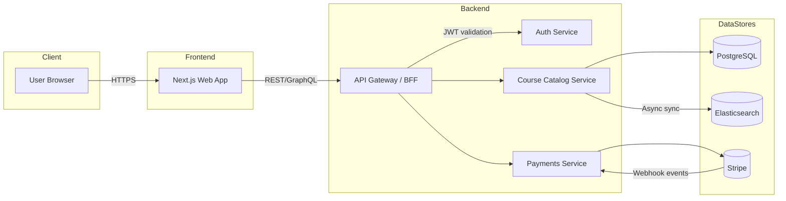

# Skillify MVP (Stack Hub)

Skillify is an MVP-scale learning platform that lets learners search, buy, and access curated courses. This document captures the high-level architecture, tech stack choices, and the roadmap to get the initial version in place.

## Product Goals
- Enable users to sign up, sign in, and manage their accounts securely.
- Provide a fast, debounced search experience across a growing course catalog.
- Support sandboxed Stripe purchases for paid content.
- Keep the architecture modular so we can scale features like recommendations or creator tooling later.

## System Overview
- `apps/web`: Next.js/React frontend, handles the learner experience, login flows, and checkout.
- `services/api`: API gateway/BFF (NestJS or Fastify) that authenticates users, orchestrates service calls, and shapes responses for the UI.
- `services/auth`: AuthN/AuthZ service wrapping a managed provider (Clerk/Auth0/Supabase Auth) and issuing JWTs.
- `services/course-catalog`: CRUD for courses, tagging, search indexing, and course metadata management.
- `services/payment`: Handles Stripe integration, webhooks, and purchase state.
- `packages/shared`: Shared TypeScript types, validation schemas (Zod), and utility code.
- `infra`: Docker Compose definitions for Elasticsearch, Stripe CLI (webhook forwarding), and supporting infrastructure.

## Architecture Diagram

### Key Interactions
- **Auth handshake**: The web app uses the Auth service for sign-up, login, password resets, and token refresh. Tokens are stored using HTTP-only cookies.
- **Course search**: Search requests hit the API gateway, which proxies to Elasticsearch. New or updated courses trigger background jobs to re-index documents.
- **Purchases**: Checkout sessions originate in the frontend, Stripe handles payment, and `services/payment` confirms the purchase via webhook before updating the database. The API gateway then exposes entitlement data back to the frontend.

## Tech Stack
- **Frontend**: Next.js 14 (App Router), React, Tailwind CSS, TanStack Query, next-auth or Auth provider SDK.
- **Backend**: TypeScript, NestJS (or Fastify + tRPC), Prisma ORM, PostgreSQL, Elasticsearch JS client, Stripe SDK, BullMQ for async jobs.
- **Infrastructure**: Docker Compose for local services (Postgres, Redis, Elasticsearch, Stripe CLI), Terraform (later) for provisioning.
- **CI/CD**: GitHub Actions for lint/test/build; deploy previews via Vercel or similar.

## Data Model Sketch
- `users`: Auth provider ID, profile metadata.
- `courses`: title, description, slug, price, status, content URL.
- `course_search_index`: denormalized course document stored in Elasticsearch.
- `purchases`: user_id, course_id, stripe_session_id, status.
- `events`: idempotent log of webhook or domain events.

## Local Development Flow
1. Install dependencies: `pnpm` or `yarn` workspaces for monorepo management.
2. Start infrastructure: `docker compose up postgres redis elasticsearch stripe`.
3. Run services:
   - `apps/web`: `pnpm dev --filter web`.
   - `services/api`: `pnpm dev --filter api`.
4. Sync course data to Elasticsearch via background worker (`pnpm dev --filter course-catalog`).
5. Use Stripe CLI for webhook forwarding: `stripe listen --forward-to localhost:4002/webhooks/stripe`.

## Implementation Roadmap
1. **Bootstrapping**
   - Initialize repo with Turbo/PNPM workspace, shared TS config, linting, and formatting.
   - Scaffold Next.js app with auth UI and course listing placeholders.
2. **Auth Integration**
   - Connect to managed auth provider.
   - Implement session storage, JWT validation, and role bindings.
3. **Course Catalog**
   - Build Postgres schema with Prisma migrations.
   - Seed sample courses and implement CRUD endpoints.
   - Implement Elasticsearch indexing worker and debounced search endpoint.
4. **Payments**
   - Integrate Stripe Checkout Sessions.
   - Implement webhook handling to verify payment and create entitlements.
5. **QA & Release**
   - Add e2e coverage (Playwright) for signup/search/checkout.
   - Configure CI pipeline, seed scripts, and production deployment manifests.

## Next Steps
- Configure workspace package manager (`pnpm init -w`) and add baseline `package.json`.
- Scaffold Next.js, API service, and shared packages with TypeScript configs.
- Add Docker Compose file for Postgres, Redis, Elasticsearch, and Stripe CLI.

Refer to `docs/architecture.md` for more granular diagrams and sequence flows as the implementation evolves.

## Build Task Checklist
- [ ] Create feature branches per functionality before starting implementation.
- [ ] Initialize PNPM/Turborepo workspace with shared TypeScript config, ESLint, Prettier, and commit hooks.
- [ ] Author `docker-compose.yml` for Postgres, Redis, Elasticsearch, Stripe CLI; add convenience scripts for startup and teardown.
- [ ] Scaffold Next.js app in `apps/web` with Tailwind, TanStack Query, and environment configuration plumbing.
- [ ] Implement base layout, home page, course list placeholder, and global UI components (navbar, auth buttons).
- [ ] Wire managed auth provider (Clerk/Auth0/Supabase), implement signup/login/logout flows, and secure routes with session handling.
- [ ] Bootstrap NestJS API gateway in `services/api` with JWT middleware, request validation, error handling, and health probes.
- [ ] Set up Prisma in `services/course-catalog`, define schema for users/courses/purchases/events, and run initial migration.
- [ ] Seed sample course data and expose CRUD endpoints for courses (list/detail/create/update).
- [ ] Integrate Elasticsearch client, provision index mappings, and build background indexer that syncs course changes.
- [ ] Expose debounced search endpoint via API gateway, implement query shaping, and integrate search UI in Next.js with optimistic states.
- [ ] Implement course detail page with purchase CTA and gated content messaging.
- [ ] Create Stripe products/prices, wire Checkout Session creation endpoint, and redirect flow from frontend.
- [ ] Handle Stripe webhooks in `services/payment`, verify signatures, persist purchase records, and emit entitlement events.
- [ ] Update API gateway to expose purchase status and entitlement checks to the frontend.
- [ ] Add account dashboard page showing enrolled courses and purchase history.
- [ ] Configure shared Zod DTOs in `packages/shared` and enforce them across services.
- [ ] Stand up Redis/BullMQ worker for background jobs (search indexing, webhook retries).
- [ ] Instrument basic observability (OpenTelemetry traces, centralized logging hooks).
- [ ] Write unit tests (Vitest/Jest) for services and component tests for UI; add Playwright e2e covering signup, search, checkout.
- [ ] Configure GitHub Actions CI for lint/test/build and preview deploys (Vercel for web, container builds for services).
- [ ] Prepare deployment manifests (Fly.io/ECS/Railway) and document environment variable requirements.
