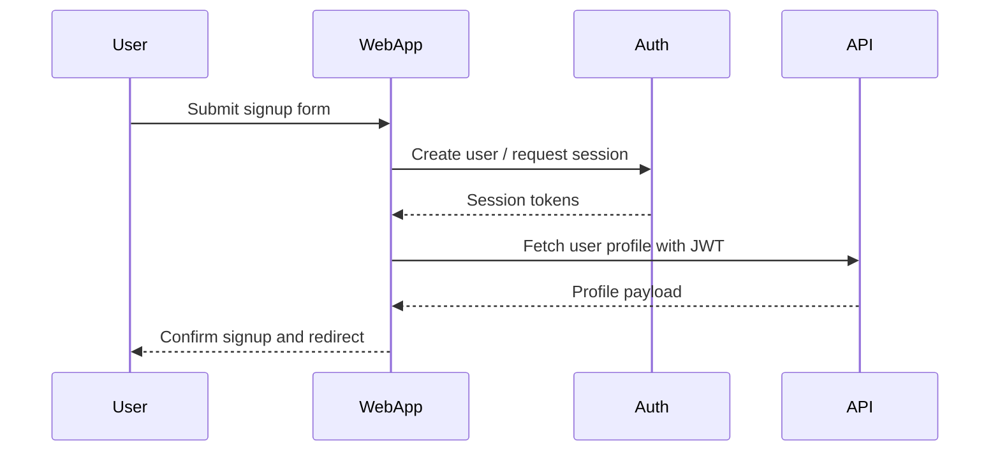
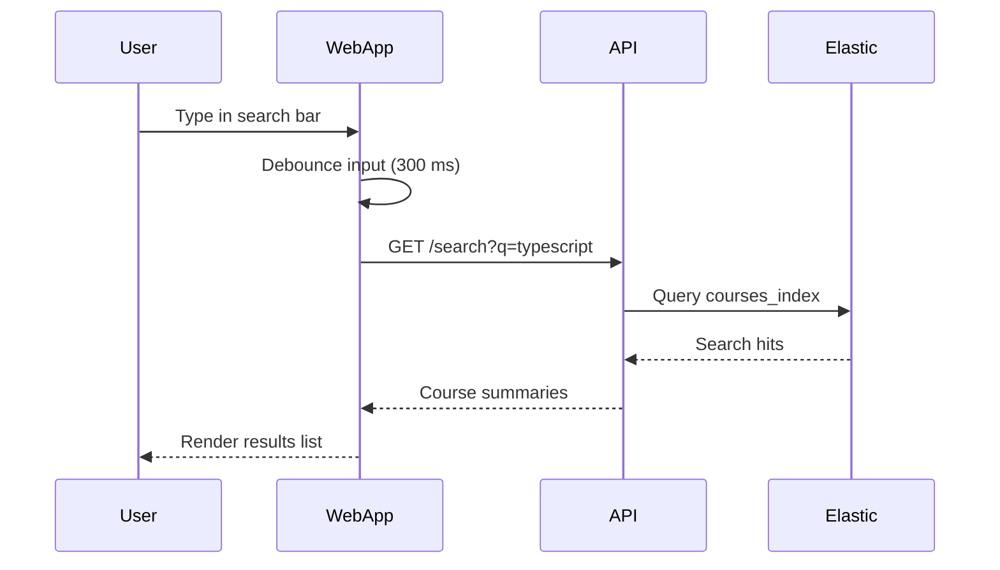
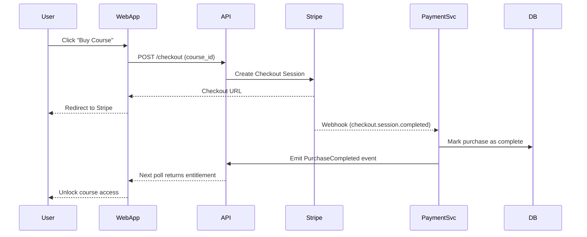

# Skillify Architecture Details

## Context
Skillify targets learners who want streamlined access to curated courses. The MVP keeps a modular monorepo structure with TypeScript so teams can iterate on frontend and backend features in parallel while sharing types and validation logic.

## Logical Components
- **Web App (`apps/web`)**: Next.js client with server actions for auth and checkout. Uses TanStack Query for data fetching and optimistic UI, and hits backend routes via a BFF layer.
- **API Gateway (`services/api`)**: NestJS service that authenticates requests, performs authorization checks, and composes responses by calling domain services.
- **Auth Service (`services/auth`)**: Wraps a managed provider (e.g., Clerk, Supabase Auth). Exposes REST endpoints to issue JWTs and manage user metadata such as subscription tier.
- **Course Catalog (`services/course-catalog`)**: Owns course CRUD, tagging, and search indexing queues. Publishes `CourseUpdated` events for the search worker.
- **Payments (`services/payment`)**: Manages Stripe Checkout Sessions, webhook verification, and purchase entitlements. Emits `PurchaseCompleted` events.
- **Shared Package (`packages/shared`)**: Houses Zod schemas, DTOs, and event contracts to ensure type-safe communication across services.
- **Infrastructure (`infra`)**: Docker Compose and IaC definitions, plus scripts for seeding databases and running local dev services.

## Deployment Model
- **Frontend**: Vercel or Netlify for instant previews and SSR support.
- **Backend Services**: Containerized deployments to Fly.io, AWS ECS, or Railway. API gateway exposes public endpoints; services communicate via private network.
- **Data Layer**: Managed PostgreSQL (Neon, Supabase) and Elastic Cloud or self-hosted cluster. Redis (Valkey) for caching and job queues.

## Sequence Diagrams

### Signup Flow

### Course Search

### Checkout

## Data Contracts
- **`Course` DTO**: `id`, `slug`, `title`, `summary`, `duration`, `price`, `tags`.
- **`Purchase` DTO**: `id`, `courseId`, `userId`, `status`, `stripeSessionId`, `accessGrantedAt`.
- **Event `CourseUpdated`**: Published by catalog to trigger re-index jobs.
- **Event `PurchaseCompleted`**: Published by payments to grant access and notify Marketing/Analytics.

## Operational Considerations
- **Observability**: Use OpenTelemetry traces across services, centralize logs in Logtail or Datadog.
- **Secrets Management**: During MVP, rely on `.env` with Doppler or 1Password. Plan migration to AWS Secrets Manager or GCP Secret Manager.
- **Testing Strategy**:
  - Unit tests with Vitest/Jest in each service.
  - Contract tests using Pact between API and domain services.
  - Playwright E2E flows covering signup, search, and checkout.
- **Security**:
  - Enforce TLS/WSS for all traffic.
  - Store Stripe secrets and webhook signing secrets securely.
  - Validate all Stripe webhook payloads using signature headers.

## Open Questions
- Which auth provider does the team prefer? (Clerk vs Auth0 vs Supabase).
- Target deployment platform for services (affects CI/CD pipeline).
- Need for a content delivery mechanism for course assets (e.g., Mux for video, S3 for documents).

Answering the above will tighten the roadmap and unlock automated deployments.

